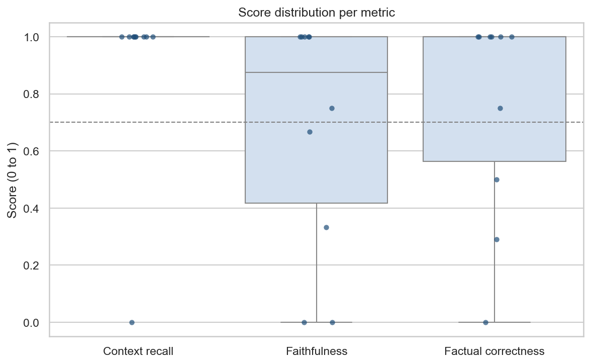
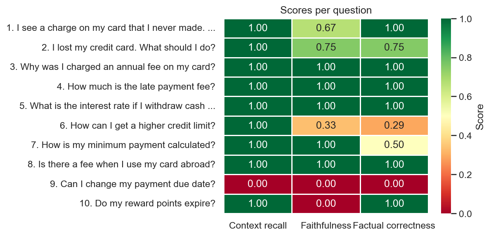
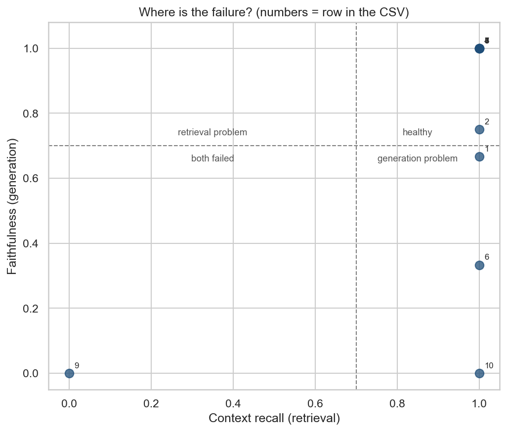

# RAG Evaluation Template
### AI for Fintech | [EVAL-001]

A template for evaluating any RAG system with Ragas, starting from a CSV. You bring the questions, the correct answers and what your RAG replied. The template validates the file, grades every answer with an LLM judge and shows where the RAG is failing: in retrieval or in generation.

It knows nothing about your RAG. The only contract is a CSV with four columns, so the same code evaluates a LangChain pipeline, a vector database with a prompt or a vendor product.


## Architecture


---

## Before You Run Anything

The notebook does not call your RAG. It grades answers that already exist, so there is work to do first, and it happens outside this repository.

**1. Write the questions and the correct answers.** Use Excel or any spreadsheet, with two columns: `user_input` and `reference`. A person should write or at least review every reference. A wrong reference makes the whole evaluation wrong, and numbers such as deadlines and limits are where that happens most.

**2. Run every question through your RAG.** For each one, record two things: the answer it generated and the chunks it retrieved to generate it.

**3. Save everything as one CSV** with four columns, at `data/eval_input.csv`.

Only then does the notebook have something to grade.

| Column | What it is | Who fills it |
|---|---|---|
| `user_input` | the question | you |
| `reference` | the correct answer | you |
| `response` | the answer your RAG generated | your RAG |
| `retrieved_contexts` | the chunks your RAG used, as a JSON list | your RAG |

One example row:

| Column | Value |
|---|---|
| `user_input` | I lost my credit card. What should I do? |
| `reference` | Report it immediately. The card is blocked right away and the replacement arrives in 5 to 7 business days. |
| `response` | Report the loss immediately. The card is blocked instantly and a replacement arrives in 5 to 7 business days. |
| `retrieved_contexts` | ["If a card is lost or stolen, the customer must report it immediately...", "Replacement cards are delivered in 5 to 7 business days..."] |

The chunks go in one cell as a JSON list of strings. If you build the file in Excel, save it as CSV UTF-8 and keep that cell as plain text.

If your RAG is a Python function, this snippet builds the file. Save your Excel sheet with the questions as `questions.csv` first.

```python
import json
import pandas as pd

questions = pd.read_csv('questions.csv')   # columns: user_input, reference

rows = []
for q in questions.itertuples():
    answer, chunks = my_rag(q.user_input)  # your RAG: answer text and a list of chunk texts
    rows.append({
        'user_input': q.user_input,
        'reference': q.reference,
        'response': answer,
        'retrieved_contexts': json.dumps(chunks, ensure_ascii=False),
    })

pd.DataFrame(rows).to_csv('data/eval_input.csv', index=False)
```

The repository ships with an example file so you can see the whole flow before building your own. See the note on it under Limitations.

---

## What This Solves

Evaluating a RAG often stops at trying a few questions by hand and deciding it feels fine. That does not tell you how bad the bad answers are, and it does not tell you why they are bad.

A wrong answer has two possible causes. Retrieval may have brought the wrong chunks, or the chunks were right and the model said something they do not support. The fixes are different: chunking and top-k in one case, prompt and model in the other.

This template grades every answer with the same three metrics and plots the results so the cause is visible. The notebook ends with a table of the failing questions, each labeled with where it went wrong.

---

## How It Works

```
CSV  ->  validate  ->  Ragas judge  ->  scores  ->  charts  ->  diagnosis
```

The notebook runs these steps in order:

```
1  Validate        checks columns, empty cells and the format of the chunk list
2  Grade           an LLM judge scores each row on three metrics, 0 to 1
3  Summarize       mean, median and spread per metric
4  Plot            boxplot, heatmap per question, recall x faithfulness scatter
5  Diagnose        retrieval, generation or incomplete answer, with the worst cases
```

Step 2 is the only one that spends API calls. The notebook has a `LIMIT` variable to grade a few rows first.

### Example Result

First 10 rows of the example CSV, graded by `gpt-4o-mini`. In this run the 30 judge calls took about a minute.

| Metric | Mean | Median | Below 0.7 |
|---|---|---|---|
| Context recall | 0.90 | 1.00 | 1 of 10 |
| Faithfulness | 0.68 | 0.88 | 4 of 10 |
| Factual correctness | 0.75 | 1.00 | 3 of 10 |

Retrieval is healthy: one failure in ten. The weak spot is generation. Two rows were built with failures on purpose and the judge caught both:

| Row | What was planted | Recall | Faithfulness | Correctness |
|---|---|---|---|---|
| 6 | answer invents "guaranteed approval" | 1.00 | 0.33 | 0.29 |
| 9 | irrelevant chunks and an invented answer | 0.00 | 0.00 | 0.00 |

The judge also scored rows 7 and 10 low, where a human reading the answer would probably accept it. That is the reason the judge itself needs validating. See What v2 Would Look Like.







---

## What Each Metric Measures

| Metric | The question it answers | A low score means |
|---|---|---|
| Context recall | Did the retrieved chunks contain what the reference answer needs? | retrieval missed information |
| Faithfulness | Is every claim in the answer supported by the retrieved chunks? | the model added or changed something |
| Factual correctness | Does the answer say the same as the reference? | the answer is wrong or incomplete |

The diagnosis follows the same logic, with one threshold in `eval_config.py` (0.7 by default):

```
low context recall        ->  retrieval problem
low faithfulness          ->  generation problem
only low correctness      ->  answer incomplete or wrong
```

---

## Project Structure

```
rag-eval-template/
├── README.md
├── requirements.txt
├── .env.example
├── .gitignore
├── eval_config.py            judge model, paths, threshold
├── src/
│   ├── __init__.py
│   ├── validation.py         checks the CSV before spending API calls
│   ├── evaluation.py         runs Ragas and saves the scores
│   └── visualization.py      charts and diagnosis
├── notebooks/
│   └── quickstart.ipynb      runs the whole flow
├── data/
│   ├── eval_input.csv        example: 25 credit card call center questions
│   └── eval_scores.csv       output of the grading step
└── figures/                  PNGs saved by the notebook
```

The logic lives in `src/`. The notebook only calls it, so the same functions can run from a script.

---

## Quickstart

### 1. Install

```bash
git clone https://github.com/junidepieri-design/eval-001-rag-evaluation-template.git
cd eval-001-rag-evaluation-template

py -3.12 -m venv venv
venv\Scripts\activate

pip install -r requirements.txt
```

On macOS or Linux, activate with `source venv/bin/activate`. If `pip install` fails while building `greenlet` on Windows, recreate the environment with Python 3.12.

### 2. Set your API key

Copy `.env.example` to `.env` and fill in the key for the judge you chose.

```
OPENAI_API_KEY=your_key_here
GOOGLE_API_KEY=your_key_here
```

Then pick the judge in `eval_config.py`:

```python
JUDGE_PROVIDER = 'google'
JUDGE_MODELS = {
    'openai': 'gpt-4o-mini',
    'google': 'gemini-2.5-flash'
}
```

Model names change and old ones get retired. If you get a model not found error, check your provider's current list.

Use a judge that is **not** the model inside the RAG you are evaluating. A model grading its own answers tends to be generous.

### 3. Build your CSV

Follow Before You Run Anything and save the file at `data/eval_input.csv`. To try the template first, skip this step and use the example.

### 4. Validate the CSV

```bash
python -m src.validation
```

It prints `OK` with the row count, or a list of every problem it found, such as `Row 7: 'reference' is empty.`

### 5. Run the notebook

Open `notebooks/quickstart.ipynb` and run the cells in order. In the grading cell, set `LIMIT = 10` for a first run, then `LIMIT = None` for the full file.

The notebook writes the scores to `data/eval_scores.csv` and the charts to `figures/`.

---

## Key Design Decisions

**The CSV is the contract.** There is no adapter and no RAG code in this repository. Anyone who can produce four columns can use it, and the evaluation never breaks when the RAG changes.

**The file is validated before any API call.** Judge calls cost money and time. A malformed chunk list found after twenty minutes of grading is a bad way to learn about it.

**The judge must differ from the RAG.** If both are the same model, scores drift upward. The config makes the judge a one-line choice.

**A failed judge call becomes an empty score, not a crash.** One timeout should not throw away the other twenty-four rows. The summary table counts the failed calls, so nothing disappears silently.

**Three metrics, on purpose.** Recall, faithfulness and correctness are enough to separate retrieval from generation. More metrics would make the charts harder to read and the bill larger.

**The diagnosis is a rule, not a verdict.** It reads three scores and one threshold. It tells you where to look first, and the decision stays with you.

**Versions are pinned.** Ragas changes its API often, and at the time of writing version 0.4.3 failed to import alongside LangChain 1.x. The `requirements.txt` fixes `ragas==0.3.9` with LangChain 0.3.x.

**The config file is not called `config.py`.** A package named `config` exists on PyPI, and when installed it shadows a local file with that name. The file is `eval_config.py` to avoid that.

---

## Limitations

**The judge is an LLM.** It has variance and bias. In the example run it scored some answers low that a person would accept. Scores also change from one judge model to another, so record which judge produced yours.

**This template does not validate the judge.** Nothing here compares its scores with human labels. Treat the numbers as a signal about where to look.

**The example CSV is synthetic.** It was written by hand: a fictional bank with invented policies, and 25 rows where seven carry failures planted on purpose (rows 6, 9, 12, 14, 18, 21 and 25). It shows how the metrics behave. It is not the output of a real RAG.

**References can be wrong.** If the correct answers were drafted by an LLM or typed in a hurry, the errors flow into every score.

**Small samples are fragile.** With 10 or 25 rows, a single question moves the mean a lot. Read the distribution, not only the average.

---

## Terms Explained

| Term | What It Means |
|---|---|
| RAG | Retrieval Augmented Generation. A system that retrieves chunks of documents and asks an LLM to answer using them. |
| Ragas | An open source library that grades RAG outputs with an LLM judge. |
| LLM judge | The model that reads the question, the chunks, the answer and the reference, and returns a score. |
| Retrieved contexts | The chunks the RAG brought back for a question. |
| Reference | The correct answer, written by a person. Also called ground truth. |
| Threshold | The score below which a result is flagged as low. 0.7 here. |

---

## What v2 Would Look Like

The next step is trusting the judge. Label 100 to 200 answers by hand, turn the judge scores into pass or fail, and compare with a confusion matrix, precision, recall and Cohen's kappa. That answers who grades the grader.

After that, retrieval metrics that need no LLM: store the source chunk of each question and measure Recall@k and MRR directly. Then keep every run in a dated folder to compare RAG versions and watch the scores drift over time. Ragas can also generate the question set from your documents, which is worth adding once a person reviews every reference it produces.

---

## Author

Built by [Odemir Depieri Jr](https://www.linkedin.com/in/odemir-depieri-jr/), Data and AI specialist with 14 years of experience in data and AI within banks and financial institutions.

Part of the AI for Fintech applied research hub.
